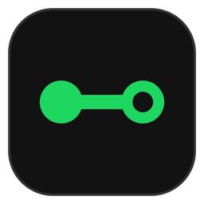
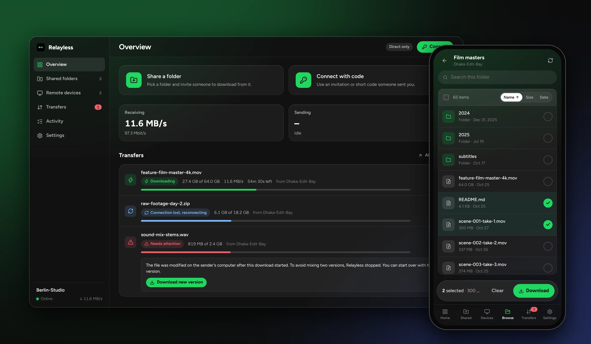
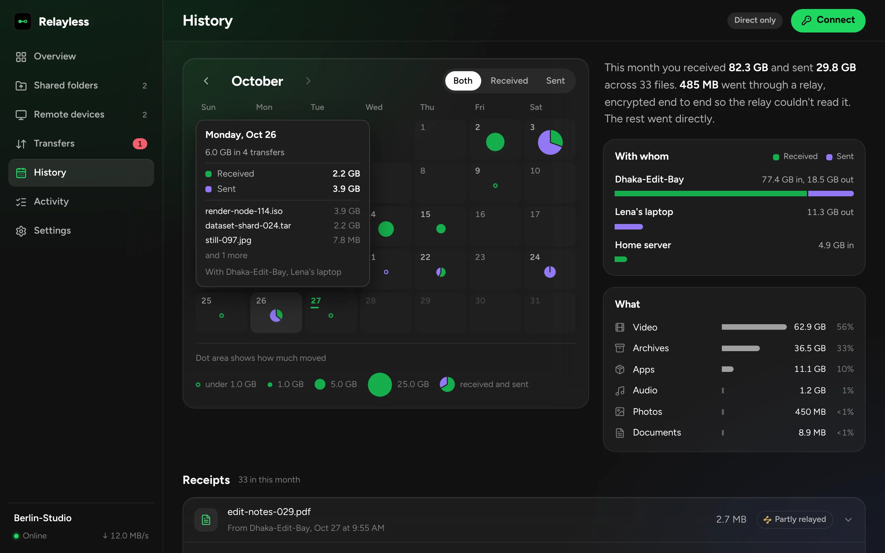
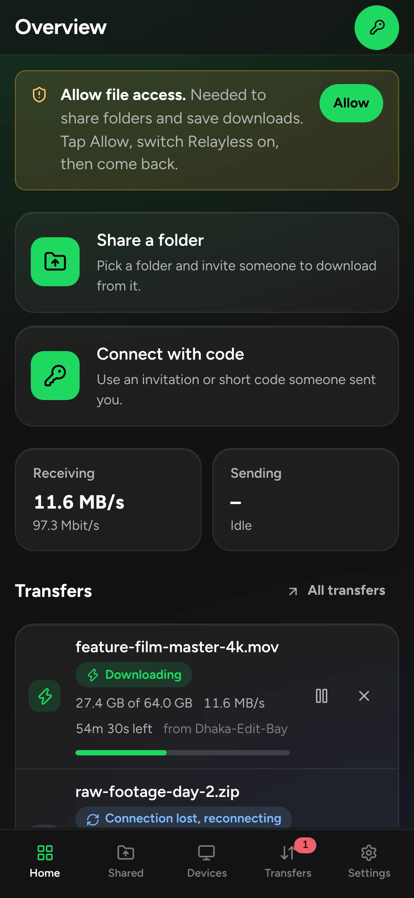
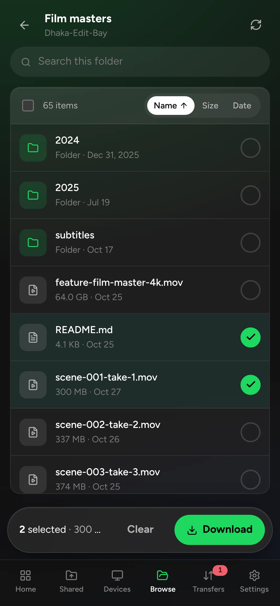
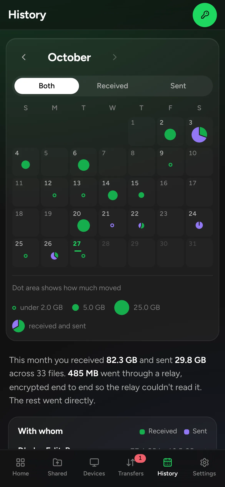
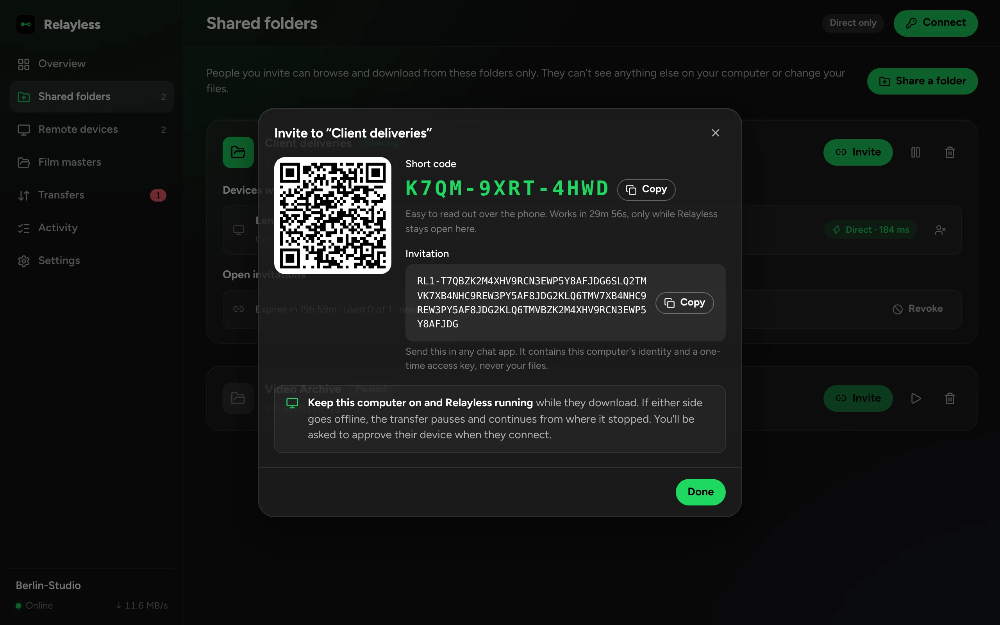
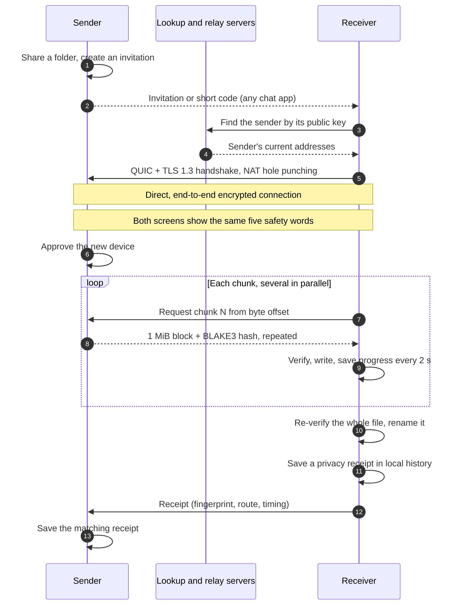

<div align="center">



# Relayless

**Your files never sit on a server.**

Direct, end-to-end encrypted transfers between Windows and Android, with a privacy receipt for every file.<br />
No account, no cloud copy, no size limit, and every transfer picks up from the last verified megabyte.

[](https://github.com/MisbahKhan0009/Relayless/releases/latest)
[](https://github.com/MisbahKhan0009/Relayless/actions/workflows/build.yml)
[](LICENSE)
[](#download)
[](https://misbahkhan0009.github.io/Relayless/)

[**Download**](https://github.com/MisbahKhan0009/Relayless/releases/latest) &nbsp;|&nbsp;
[Website](https://misbahkhan0009.github.io/Relayless/) &nbsp;|&nbsp;
[Privacy](#privacy-you-can-check) &nbsp;|&nbsp;
[How it works](#how-it-works) &nbsp;|&nbsp;
[Architecture](docs/ARCHITECTURE.md) &nbsp;|&nbsp;
[Contributing](CONTRIBUTING.md)

<br />



</div>

<br />

## Privacy you can check

Most tools ask you to trust that they are private. Relayless shows you.

- **A receipt for every transfer.** When a file finishes, both devices keep a receipt: the route it took (direct, or how many bytes a relay carried, encrypted), the encryption, how many 1 MiB blocks were verified, a file fingerprint that matches on both sides, and what servers stored. The answer to that last one is always *nothing*.
- **Safety words.** When a device asks for access, both screens show the same five words derived from the two devices' keys. Read them to each other; matching words mean no one is in the middle.
- **History that stays home.** A month calendar with a dot for each day (bigger dot, more data), totals per device and per file type, all computed on the device from its own receipts. Keep it for a year, 90 days, 30 days, forever or not at all, with or without file names.
- **Who sees what.** File names, contents, listings and history exist only on the two devices. The coordination service sees device IDs and IP addresses so the devices can find each other, and nothing else. There is no Relayless server, account or analytics.

<p align="center"></p>

## Why Relayless

Sending a 64 GB file across continents usually means uploading it to someone else's server, waiting, then downloading it again, and starting over when the connection drops. Relayless sends it once, directly from the sender's disk to the receiver's, and treats interruptions as normal: pause it, lose Wi-Fi, reboot either machine, and it continues from where it stopped.

- **No middleman storage.** Files travel device to device over an end-to-end encrypted connection. Nothing is uploaded anywhere.
- **Built for unreliable links.** Progress is verified and saved every megabyte, so an interruption costs seconds, not hours.
- **Fast over long distances.** QUIC with BBR congestion control and parallel streams keep a high-latency link full.
- **Light on the machine.** Files stream from disk in small blocks; the app runs at low CPU priority and never loads a file into memory.
- **Free and open source.** MIT licensed, no account, no telemetry.

## Features

| | |
|---|---|
| **Resumable to the megabyte** | Every 1 MiB block is hash-checked on arrival and saved to disk. Pauses, crashes, reboots and dropped connections resume from the last verified block. |
| **Whole-file verification** | After the last block, the file is read back and verified once more before it gets its final name. Corrupt data is fetched again automatically. |
| **Share exactly one folder** | The sender chooses a folder; nothing outside it can be listed or read. Receivers can't change or delete anything. |
| **Invitations and short codes** | Share an invitation in any chat app, or read out a 12-character code. New devices need your approval. |
| **Browse before downloading** | Search the shared folder, pick single files or whole folders, and choose where they go. |
| **Direct-only by default** | The route (direct or relayed) is always visible. In direct-only mode, file data never passes through a relay. |
| **Source change detection** | If the sender edits the file mid-transfer, Relayless stops instead of mixing two versions, and offers to start over. |
| **Live speed graph** | Receive and send speed over the last two minutes, with markers for pauses, reconnects and route changes. |
| **Privacy receipts and history** | A receipt per finished file and a local calendar of what moved, with whom and what kind of files. Never uploaded. |
| **Safety words** | Five words, identical on both devices, to confirm a new pairing out loud. |
| **Windows and Android** | Windows 10/11 and Android 7.0+, in any combination. On Android, transfers continue with the screen off. |

## Screenshots

<table>
  <tr>
    <td width="33%"></td>
    <td width="33%"></td>
    <td width="33%"></td>
  </tr>
  <tr>
    <td colspan="3"></td>
  </tr>
</table>

## Download

| Platform | File | Requirements |
|---|---|---|
| **Windows** | `Relayless-Setup-<version>-x64.exe` | Windows 10 or 11, 64-bit. No administrator rights needed. |
| **Android** | `Relayless-<version>-android.apk` | Android 7.0 or newer. One universal APK for every phone and tablet. |

Get both from the **[latest release](https://github.com/MisbahKhan0009/Relayless/releases/latest)**. Each release includes SHA-256 checksums. Both devices need the same version.

> [!NOTE]
> The builds aren't code-signed by a certificate authority yet. On Windows, SmartScreen may show *Windows protected your PC*: choose **More info → Run anyway**. On Android, allow your browser or file manager to install apps; if Play Protect warns, choose **More details → Install anyway**.

### Quick start

1. **On the device with the files:** open **Shared folders → Share a folder**, then **Invite**. Send the invitation or read out the short code.
2. **On the receiving device:** tap **Connect**, paste the invitation or type the code, then wait for the sender to approve.
3. Browse the folder, select what you need and tap **Download**. Follow progress under **Transfers**.

Both devices need to be online while files move. On Android, allow **All files access** and, for long transfers, **Settings → Android → Run in the background**.

## How it works



The lookup and relay servers (run by the [iroh](https://iroh.computer) project) only help the two devices find each other and punch through routers. They never see file names, contents or your history; receipts travel only between the two devices, inside the encrypted connection. In the default **direct-only** mode, no file data passes through a relay at all; if your network blocks direct paths, you can allow encrypted relay fallback in Settings.

Read more in [docs/ARCHITECTURE.md](docs/ARCHITECTURE.md).

## Performance

- **Throughput:** QUIC with BBRv3 congestion control and 12 parallel streams per file (configurable up to 32). Twelve streams sustain roughly 480 Mbit/s at a 200 ms round trip. Real speed is capped by the slower connection, usually the sender's upload.
- **Memory:** files are streamed in 1 MiB blocks and never loaded whole. A 1 GiB loopback transfer peaked at about 110 MB for sender and receiver combined. The Windows app process uses around 45 MB at rest.
- **CPU:** BLAKE3 hashing and UDP segmentation offload keep the cost per byte low, and the process runs at below-normal priority so other apps stay responsive.
- **Your bandwidth, your call:** optional upload and download limits.

## Security

- **Encryption and identity:** every connection uses QUIC with TLS 1.3, authenticated by each device's Ed25519 key. The receiver verifies it reached exactly the sender named in the invitation.
- **Invitations:** random 128-bit keys, stored only as hashes. They expire, can be limited to a number of devices, and can be revoked. New devices need approval by default.
- **Short codes:** stretched with Argon2id; they unlock an encrypted record, so the lookup service never sees the invitation.
- **Access control:** the sender checks every request. Path traversal, symlinks and junctions that leave the shared folder are refused. Incoming file names are sanitized before anything is written.
- **Integrity:** each 1 MiB block is verified with BLAKE3 on arrival, and the whole file again before it is finalized.
- **Safety words:** five words from a 256-word list (40 bits), derived with BLAKE3 from both devices' public keys, sorted, so both sides compute the same words.
- **Local-only history:** receipts and statistics live in the app's SQLite database on each device, pruned by the retention setting. The receiver sends the sender a receipt over the existing encrypted connection; nothing goes anywhere else.

Found a vulnerability? Please follow [SECURITY.md](SECURITY.md) instead of opening a public issue.

## Build from source

**Requirements:** Rust (stable), Node.js 22. On Windows, the WebView2 runtime (preinstalled on Windows 10 and 11). For Android: JDK 21, Android SDK and NDK.

```sh
git clone https://github.com/MisbahKhan0009/Relayless
cd Relayless
npm ci

npm run tauri dev                         # run the desktop app
npm run dev:ui                            # UI only, with demo data, in a browser
cargo test -p relayless-core --release    # engine tests

npx tauri build --bundles nsis            # Windows installer
npx tauri android build --apk             # Android APK
```

The engine tests run real transfers between two in-process peers and cover pause and resume (including mid-chunk), crash recovery, corrupted data, the sender going offline, source changes, path traversal and access revocation.

### Continuous integration

Every push to `main` runs the engine tests on Linux and Windows, builds the Windows installer and the Android APK, installs and launches each one (on a clean Windows runner and an Android 13 emulator), and publishes a GitHub Release with both files attached. Android builds are signed with one key across releases so updates install in place; see [Android signing](docs/ARCHITECTURE.md#android-signing).

## Project structure

```
crates/core/                 Transfer engine (Rust): protocol, sharing, invitations,
                             resumable downloads, SQLite state, end-to-end tests
src-tauri/                   App shell (Tauri 2): commands, events, Windows tray,
                             Android project in gen/android
plugins/relayless-android/   Android integration (Kotlin): storage access,
                             foreground transfer service, battery settings
src/                         Interface (React + TypeScript): pages, live speed
                             graph (flow.tsx), History calendar and receipts
mock/                        Demo backend for `npm run dev:ui`
website/                     Project website, published to GitHub Pages
docs/                        Architecture and protocol notes
PRODUCT.md                   Who Relayless is for and the principles it keeps
DESIGN.md                    Visual system: colours, type, chart and calendar rules
```

## Roadmap

- [x] Direct, encrypted, resumable transfers on Windows and Android
- [x] Per-megabyte resume and whole-file verification
- [x] Invitations, short codes and device approval
- [x] Privacy receipts, safety words, local history and live speed graph
- [ ] Code-signed Windows installer
- [ ] macOS and Linux builds
- [ ] Self-hostable relay and lookup server
- [ ] Send from the phone's share sheet
- [ ] Optional folder sync

Ideas and votes are welcome in [Issues](https://github.com/MisbahKhan0009/Relayless/issues).

## Contributing

Contributions of every size are welcome: bug reports, translations, docs and code. Start with [CONTRIBUTING.md](CONTRIBUTING.md), and please follow the [Code of Conduct](CODE_OF_CONDUCT.md).

## License

Relayless is released under the [MIT License](LICENSE).

## Acknowledgements

Relayless stands on [iroh](https://github.com/n0-computer/iroh) for peer-to-peer QUIC and hole punching, [Tauri](https://tauri.app) for the apps, [BLAKE3](https://github.com/BLAKE3-team/BLAKE3) for hashing and [SQLite](https://sqlite.org) for durable state.
