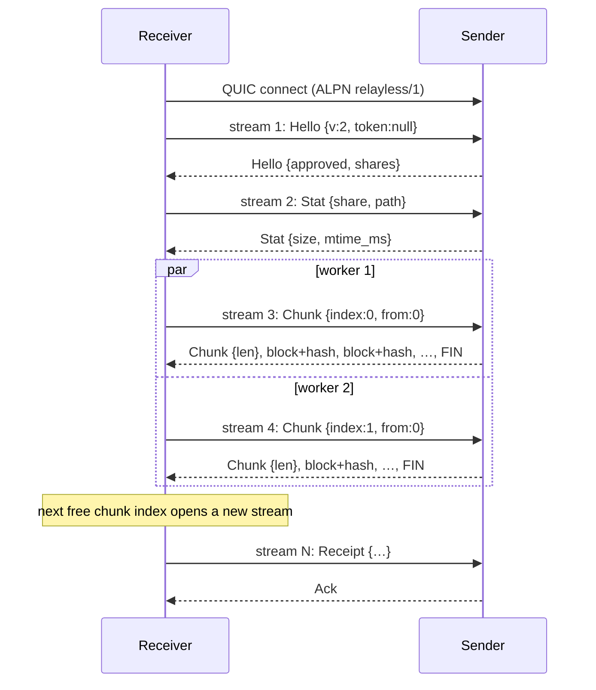

# Transfer protocol

This document describes how Relayless moves file data between two devices: the transport, the wire format, how files are split into chunks and blocks, how data is verified, buffered, persisted and resumed, and which constants control each part. It is meant as a reference for changing the protocol or tuning performance.

The higher-level overview (pairing, invitations, history, platform integration) is in [ARCHITECTURE.md](ARCHITECTURE.md).

## Where the code lives

| File | What it does |
|---|---|
| `crates/core/src/proto.rs` | Wire types (`Request`, `Response`), framing (`write_frame`, `read_frame`), size limits, chunk hash, path validation |
| `crates/core/src/net.rs` | QUIC endpoint setup, flow-control windows, congestion control, route (direct/relay) inspection |
| `crates/core/src/sender.rs` | Accepts connections and streams, authorizes requests, serves chunks from disk (`serve_chunk`) |
| `crates/core/src/receiver.rs` | Connection cache, job runner (`run_job`), download pass (`transfer_pass`), chunk download (`fetch_chunk`), progress committer (`commit_loop`), final check (`verify_and_finalize`) |
| `crates/core/src/db.rs` | `jobs`, `chunks`, `partials` tables; `commit_progress`; file fingerprint |
| `crates/core/src/util.rs` | Positional file I/O, `RateLimiter`, `backoff`, `open_source` |
| `crates/core/src/types.rs` | User settings that affect transfers (`parallel_streams`, `chunk_size_mib`, limits, congestion) |
| `crates/core/src/lib.rs` | Creates download jobs (`chunk_size`, `total_chunks`, `.rlpart` path) |
| `crates/core/src/diag.rs` | Transfer diagnostics: stage timers, stream gauges, route tracking, JSON summaries ([DIAGNOSTICS.md](DIAGNOSTICS.md)) |

Roles: the **sender** is the device that shares a folder and runs the server side. The **receiver** opens the connection, sends every request, and pulls data. The sender never pushes data on its own.

---

## 1. Transport

Relayless runs on [iroh](https://github.com/n0-computer/iroh), which gives QUIC (TLS 1.3) between Ed25519 public keys, hole punching, and relay fallback. Encryption and packet integrity come from QUIC. Relayless adds its own BLAKE3 checks on top for end-to-end file integrity (disk read on the sender to memory on the receiver, and again from the receiver's disk at the end).

- **ALPN:** `relayless/1` (`proto::ALPN`). This is the connection-level identifier and has not changed with protocol version 2.
- **Protocol version:** `PROTOCOL_VERSION = 2`, checked only in `Hello`.
- **One connection per peer pair.** The receiver keeps one cached `Connection` per sender (`receiver::get_conn`). All jobs from that sender, and all their chunk streams, share it.
- **One bidirectional stream per request.** No stream is reused. Uni-directional streams are disabled (`max_concurrent_uni_streams = 0`).

### QUIC transport settings (`net::transport_config`)

| Setting | Value | Meaning |
|---|---|---|
| `stream_receive_window` | `STREAM_WINDOW = 1_000_000` bytes | Max unacknowledged data in flight per stream |
| `receive_window` | 4 MiB initially, then adaptive between 128 KiB and `CONN_WINDOW = 48 MiB` (see section 8) | Max unacknowledged data per connection, all streams together. `RELAYLESS_ADAPTIVE_WINDOW=0` restores the static 48 MiB |
| `send_window` | `SEND_WINDOW = 48 MiB` | Max data buffered for sending per connection |
| `max_concurrent_bidi_streams` | 64 | How many streams the *peer* may have open to us at once |
| `keep_alive_interval` | 5 s | Keeps NAT bindings and relay paths alive |
| `max_idle_timeout` | 40 s | Connection is dropped after 40 s of silence |
| Congestion control | Cubic (default) or BBRv3 | Setting `congestion`, applied at next start. Installs that had BBR are moved to Cubic once (`congestion_v2`) |

Why the per-stream window is small: the QUIC stack aborts a connection if one stream's reassembly buffer holds more than 1024 separate fragments. Under heavy scattered loss, a large window allows that many holes. Keeping the window below ~1024 minimum-size packets (~1 MB) makes that impossible. Throughput comes from running many streams in parallel instead.

---

## 2. Framing and encoding

### Control frames

Every control message (requests and JSON responses) is one frame:

```
+----------------------+-----------------------------+
| length: u32 big-end. | body: UTF-8 JSON (length B) |
+----------------------+-----------------------------+
```

- `write_frame` serializes with `serde_json`, refuses bodies larger than `MAX_FRAME` (4 MiB), and writes the 4-byte length then the body.
- `read_frame` reads 4 bytes, rejects a length above `MAX_FRAME`, reads the body, and deserializes.
- JSON was chosen for readability and easy evolution; it is only used for small control messages. File bytes are never JSON-encoded.

### JSON shape

Requests are internally tagged with `"t"`, responses with `"r"`, both in `snake_case`. Unknown fields are ignored (no `deny_unknown_fields`), and fields marked `#[serde(default)]` may be left out.

```json
{"t":"chunk","share":"a1b2","path":["Videos","trip.mp4"],"size":734003200,
 "mtime_ms":1761800000000,"chunk_size":16777216,"index":3,"from":2097152,"have":52428800}
```

```json
{"r":"chunk","len":14680064}
{"r":"error","code":"source_changed","message":"The file changed on the sender's computer."}
{"r":"ack"}
```

`Response::Hello` wraps a struct, so its fields sit next to the tag: `{"r":"hello","status":"approved","sender_name":"…","shares":[…],"message":null}`.

### Chunk data stream

After a `Chunk` response, the sender writes raw binary with no further framing. The receiver knows the layout from `len` and `BLOCK`:

```
receiver -> sender:  [len][Request::Chunk JSON]  FIN

sender -> receiver:  [len][{"r":"chunk","len":L}]
                     [block 0: min(1 MiB, remaining) bytes][BLAKE3(block 0): 32 bytes]
                     [block 1 ...                         ][BLAKE3(block 1): 32 bytes]
                     ...
                     [last block (may be short)           ][BLAKE3(last):    32 bytes]  FIN
```

`L = chunk_len - from`. Hash overhead is 32 bytes per MiB (0.003%).

### Limits enforced on network input (`proto.rs`)

| Constant | Value | Applies to |
|---|---|---|
| `MAX_FRAME` | 4 MiB | Any JSON frame, both directions |
| `MAX_CHUNK` | 64 MiB | Largest `chunk_size` the sender accepts |
| `BLOCK` | 1 MiB | Verification and resume unit |
| `MAX_LIST_PAGE` | 1000 | Entries per `List` page |
| `MAX_WALK_FILES` | 50,000 | Files returned by one `Walk` |
| `validate_components` | ≤128 components, each ≤255 bytes, no `.`/`..`/`/`/`\`/`:`/NUL | Every remote path |

---

## 3. Requests

| Request | Response | Used for |
|---|---|---|
| `Hello { v, token?, device_name }` | `Hello { status, … }`, possibly preceded by `Hello { status: pending }` frames | First request on every new connection; pairing with an invitation token |
| `List { share, path, offset, limit }` | `List { entries, total }` | Browsing one folder page |
| `Walk { share, path }` | `Walk { files, truncated }` | Expanding a folder download into files |
| `Stat { share, path }` | `Stat { size, mtime_ms, dir }` | Job creation, and checking the source at the start of every download pass |
| `Chunk { share, path, size, mtime_ms, chunk_size, index, from, have? }` | `Chunk { len }` then the data stream | File data |
| `Receipt { … }` | `Ack` | Sent once after a file is verified, so the sender keeps a history entry |

Any request can get `Error { code, message }` instead.

### Stream lifecycle (sender, `handle_stream`)

1. Accept a bi stream, read one request frame (30 s timeout).
2. Authorize: the share must be active and the peer must hold a grant for it (`authorize`). This happens on every request, not once per connection.
3. Write the response (and chunk data).
4. `finish()` the send side and wait for the peer to acknowledge (`stopped()`).

### Request helper (receiver, `receiver::request`)

Open a bi stream, write the frame, `finish()`, then wait up to `READ_TIMEOUT` (60 s) for one response frame. `Error` responses are mapped to `JobError` by `remote_err`.



---

## 4. Chunks, blocks and hashes

A file is divided twice:

- **Chunk** (default 16 MiB, setting `chunk_size_mib`, clamped to 8–32 MiB): unit of a request and of parallelism. One chunk = one stream. `total_chunks = ceil(size / chunk_size)`. The last chunk may be short.
- **Block** (fixed 1 MiB, `BLOCK`): unit of verification, writing, and resume inside a chunk. The last block of a chunk may be short.

The chunk size is fixed per job when the job is created (`lib.rs`) and stored in the `jobs` row, so changing the setting only affects new downloads. The sender accepts `64 KiB ≤ chunk_size ≤ 64 MiB` and requires it to be a multiple of `BLOCK`, so in practice it must be a whole number of MiB.

### Hashes

| Hash | Formula | Stored where |
|---|---|---|
| Block hash | `BLAKE3(block bytes)` | Sent on the wire after each block; kept in `partials.hashes` until the chunk finishes |
| Chunk hash (scheme 2) | `BLAKE3("relayless-chunk-v2" ‖ h0 ‖ h1 ‖ …)` over the chunk's block hashes (`chunk_hash_from_blocks`) | `chunks.hash`, `chunks.scheme = 2` |
| Chunk hash (scheme 1, legacy v1) | `BLAKE3(chunk bytes)` | `chunks.scheme = 1`; still accepted by the final check |
| File fingerprint | `BLAKE3("relayless-file-v1" ‖ chunk hashes in order)`, hex | History rows and `Receipt` |

The block hash comes from the sender over the same encrypted stream, so it protects against read errors, a file changing while it is read, and receiver-side memory or write problems. It does not protect against a dishonest sender, which is trusted by design.

---

## 5. Download flow on the receiver

### Job runner (`run_job`)

```
Queued ──slot──> Connecting/Reconnecting ──> (WaitingPeer | WaitingDirect) ──> Downloading ──> Verifying ──> Completed
                       ^                                                         |               |
                       └──────────── backoff on Network/Busy errors ─────────────┘   bad chunks ─┘ (re-download)
```

1. **Job slot.** `inner.slots` limits concurrent files to `max_concurrent_jobs` (default 2, range 1–6).
2. **Connect.** `get_conn` reuses the cached connection or dials (30 s timeout) and sends `Hello` without a token. Anything except `Approved` makes the job *needs attention*.
3. **Direct grace.** On the first attempt, if the route is a relay, wait up to `DIRECT_GRACE` (5 s, was 15 s) for hole punching. In direct-only mode, wait for a direct path and do not send any data request until one exists.
4. **Download pass** (`transfer_pass`, below).
5. **Final check** (`verify_and_finalize`), then rename and send `Receipt`.

### Download pass (`transfer_pass`)

1. `Stat` the remote file. If `size` or `mtime_ms` differ from the job row, fail with `SourceChanged`. The job never mixes two versions of a file.
2. `prepare_partial` opens `<dest>.rlpart`. If it is new or its length differs from the file size, stored progress is cleared, free space is checked (needs file size + 64 MiB), and the file is pre-allocated with `set_len(size)`.
3. Load progress from SQLite: finished chunk indices from `chunks`, verified prefixes from `partials`. Partial rows that don't fit (wrong hash count, index out of range) are ignored.
4. Build the work queue: partly done chunks first, then the remaining chunks in index order.
5. Spawn `min(parallel_streams, missing chunks)` workers (default 12, range 1–32) and one committer task.
6. Each worker pops an index and calls `fetch_chunk` until the queue is empty or an error occurs. On error the index goes back to the front of the queue and the pass is cancelled; the most severe error from all workers is reported.

### Chunk download (`fetch_chunk`)

1. Look up the chunk's verified prefix `done` (block-aligned) and its block hashes.
2. Open a new bi stream; send `Chunk { index, from: done, have }`. `have` is the receiver's total bytes for the file, only used for the sender's progress display.
3. Read the `Chunk { len }` header (60 s timeout, extended while the connection delivers data; see `wait_live` below). `len` must equal `chunk_len - done`.
4. For each block:
   1. `download_limiter.acquire(n)` (rate limit).
   2. Read `n` bytes into a reusable 1 MiB buffer with `recv.read`. Each read has a `STALL_TIMEOUT` of 90 s (also extended by `wait_live`); arriving bytes are counted in `h.arriving` so the UI moves even on slow links.
   3. Read the 32-byte hash.
   4. On a blocking thread: hash the buffer; if it matches, `write_all_at` (positional write) at `chunk_offset + done`.
   5. Count the block as `inflight` (verified, written, not yet durable). Record direct vs relay bytes from the current route.
   6. Update the in-memory partial and send `Progress::Partial` to the committer.
   7. Every 8 blocks in direct-only mode, stop if the route became a relay.
5. When the chunk is complete, send `Progress::Done { hash: chunk_hash_from_blocks(..) }`.

A hash mismatch stops the stream and returns `Corrupt`. The worker puts the chunk at the back of the queue and retries it, resuming from the last good block, up to 5 times per worker. After that the job fails with "Data kept failing verification".

### Committer (`commit_loop`)

The committer is the only place progress becomes durable:

1. Collect `Partial` and `Done` messages (wakes at least every 500 ms).
2. Commit when **2 s** have passed (`COMMIT_INTERVAL`), **≥ 256 MiB** of new progress has piled up, or all workers have stopped.
3. Commit = `fsync` the `.rlpart` file (`sync_data`), **then** one SQLite transaction (`db.commit_progress`) that inserts finished chunks, upserts or deletes partial rows, and updates `verified_bytes` and stats.

Because the flush happens before the database write, the database never claims bytes that are not on disk. After a crash, power loss or pause, at most the last ~2 s of data is fetched again, and each chunk resumes from its last saved block.

### Final check (`verify_and_finalize`)

When every chunk is recorded, the whole `.rlpart` file is read again in 1 MiB blocks and each chunk hash is recomputed (scheme 1 or 2). Bad chunks are removed from `chunks` and downloaded again. If all match, the file is renamed to its final name (`unique_path` adds ` (1)` etc.), the job is marked complete, a history row is written and a `Receipt` is sent in the background.

---

## 6. Serving a chunk on the sender (`serve_chunk`)

1. Validate `chunk_size`, `index` and `from` (must be block-aligned and inside the chunk). Reject with `BadRequest` otherwise.
2. In direct-only mode, refuse with `RelayBlocked` if the route is a relay.
3. Resolve the path inside the share (canonicalized, must stay under the root) and open it with `open_source`. On Windows this opens with read-only sharing to block writers while reading, and falls back to shared access if a writer already holds the file. Sharing violation (OS error 32) maps to `InUse`.
4. Compare the file's size and mtime with the request; mismatch gives `SourceChanged`.
5. Write `Chunk { len: len - from }`.
6. Loop over blocks:
   1. `upload_limiter.acquire(n)`.
   2. On a blocking thread: `read_exact_at` into a reusable 1 MiB buffer, then re-check size and mtime, then BLAKE3 the block. If the file changed, reset the stream with code 2.
   3. `write_all(block)` then `write_all(hash)`. These calls wait when QUIC flow control or the send buffer is full; this is the backpressure.
   4. Every 8 blocks in direct-only mode, reset with code 3 if the route became a relay.
7. `finish()` the stream.

---

## 7. Buffers and memory

| Buffer | Size | Count |
|---|---|---|
| Receiver block buffer | 1 MiB | One per worker (moved to a blocking thread for hashing and writing, then reused) |
| Sender block buffer | 1 MiB | One per chunk stream being served |
| QUIC receive buffer per stream | up to `STREAM_WINDOW` (~1 MB) | Per open stream |
| QUIC receive buffer per connection | up to `CONN_WINDOW` (48 MiB) | Per connection |
| QUIC send buffer | up to `SEND_WINDOW` (48 MiB) | Per connection |
| Progress channel | unbounded `mpsc`, one small message per block | Per download pass |

Rough receiver memory for one active job with 12 workers: 12 MiB of block buffers plus up to ~12 MB in QUIC reassembly.

Disk I/O is positional (`pread`/`pwrite`, or `seek_read`/`seek_write` on Windows), so many workers can share one `File` handle without seeking. All file I/O and hashing run on `spawn_blocking` threads so they don't stall the async network tasks.

---

## 8. Throughput, flow control and concurrency

### Adaptive connection window (`flow.rs`)

The receiver sizes the connection's flow-control window (`MAX_DATA`) to `delivery rate × (base RTT + 100 ms)`, re-evaluated every 200 ms. That is one bandwidth-delay product plus about 100 ms of queue, so the sender can keep the bottleneck busy but can't build a deep queue in front of it, whatever its congestion controller does.

- Delivery rate is the maximum of 1 s rates over the last 2 s; base RTT is the lowest smoothed RTT on the current path.
- The window shrinks only when the RTT shows a queue above the target; an idle connection keeps its window. When the window is the limit, it grows by about `(base + 100 ms) / RTT` per step.
- A drain probe (window at ~50 ms of data until the RTT stops falling) re-measures the base RTT after 30 s of queueing and at most every 60 s while data flows. A path change resets the estimates.
- Limits: 128 KiB to 48 MiB; 4 MiB is advertised in the handshake, because the initial `MAX_DATA` can't be withdrawn.
- No wire change; it works with older senders. The current state is in the receiver summary under `transfer.flow_window` and in interval samples (`flow_window_bytes`, `flow_base_rtt_ms`).

Why: on the relay path in the field data, the old static setup let 12 MB queue at the relay (12 streams × 1 MB stream windows), giving 2–33 s RTT, 10–30 % loss, bursts followed by tens of seconds at zero, stall timeouts and an idle-timeout disconnect.

Each stream can have at most `STREAM_WINDOW` bytes unacknowledged, so one stream's speed is capped at about:

```
per-stream ceiling ≈ STREAM_WINDOW / RTT
connection ceiling ≈ min(parallel streams × STREAM_WINDOW, CONN_WINDOW) / RTT
```

| RTT | One stream | 12 streams (default) | 32 streams |
|---|---|---|---|
| 10 ms | ~800 Mbit/s | link-limited | link-limited |
| 50 ms | ~160 Mbit/s | ~1.9 Gbit/s | ~5 Gbit/s |
| 200 ms | ~40 Mbit/s | ~480 Mbit/s | ~1.3 Gbit/s |

These are flow-control ceilings. Real throughput is also limited by congestion control, loss, disk speed and CPU.

Concurrency limits that interact:

- Chunk streams per connection = `parallel_streams` × running jobs from the same sender. With maximum settings that is 32 × 6 = 192, but the sender allows only 64 concurrent bidi streams; extra `open_bi` calls wait until a stream closes.
- `CONN_WINDOW` (48 MiB) becomes the limit above ~48 concurrent streams.
- `Stat` and `Receipt` requests use the same stream budget as chunk streams.

### Rate limiting (`util::RateLimiter`)

One token bucket per direction (`upload_limiter` on the sender, `download_limiter` on the receiver), shared by all streams and peers. The rate is in KiB/s from settings (0 = unlimited), converted to bytes/s with a saturating multiply (`util::kib_to_bytes_per_sec`), and can change at runtime. The bucket starts empty, so the first block after start-up waits up to `n / rate`. When both devices set a limit, the lower one wins. Tokens are taken per block before it is read or received. Burst capacity is `max(25% of rate, 256 KiB)`. When the bucket is full, a 1 MiB block is allowed even if burst is smaller, and the bucket goes negative, so the average rate still holds. Waits are capped at 1 s per loop.

---

### Multi-connection transfers (`mmc.rs`)

On direct paths the receiver may open up to `max_connections` (default 8) QUIC connections to one sender and spread chunk streams over them, keeping each extra connection only while it raises goodput (MMCFTP-style). Each connection has its own congestion controller, which matters on long lossy paths where one loss-based controller is the limit. See [MULTI_CONNECTION.md](MULTI_CONNECTION.md).

## 9. Timeouts, errors and retries

### Timeouts

| Where | Constant | Value |
|---|---|---|
| Dial | `CONNECT_TIMEOUT` | 30 s |
| Sender reads request frame | inline | 30 s |
| Receiver waits for a response frame | `READ_TIMEOUT` | 60 s |
| No bytes on a chunk stream | `STALL_TIMEOUT` | 90 s |
| Chunk header or data wait while the connection still receives bytes | `LIVE_WAIT_CAP` | 10 min |

For chunk streams, `READ_TIMEOUT` and `STALL_TIMEOUT` fire only if no chunk bytes arrived from that sender on any connection during the period (`receiver::wait_live`); a dead connection is still caught by QUIC's 40 s idle timeout. A single stream can wait minutes on a busy connection: QUIC charges connection flow control when the sender buffers data, and noq wakes writers blocked on it in LIFO order, so when the receive window is the limit the oldest writer, often a new chunk's reply header, is passed over. Before this change that queueing dropped the connection about once a minute on a 100 ms / 1 % loss path, and with low sender upload limits (issue 9).
| Hello waiting for approval | inline (receiver) / `APPROVAL_TIMEOUT` (sender) | 20 min / 15 min |
| Wait for direct path on first attempt | `DIRECT_GRACE` | 5 s |
| QUIC idle | `max_idle_timeout` | 40 s |

### Error codes (`ErrCode` → `JobError`)

| Wire code | Receiver treats as | Result |
|---|---|---|
| `denied` | `Denied` | Needs attention |
| `not_found` | `Missing` | Needs attention |
| `source_changed` | `SourceChanged` | Needs attention (user can restart from the new version) |
| `relay_blocked` | `RelayBlocked` | Wait 5 s for a direct path, retry |
| `in_use`, `io` | `Busy` | Backoff and retry |
| `bad_request` | `Fatal` | Failed |
| (stream/connection errors, timeouts) | `Network` | Drop connection, backoff and retry |

### Stream and connection codes

| Code | Sent by | Meaning |
|---|---|---|
| Stream reset 2 | Sender | File changed while serving the chunk |
| Stream reset 3 | Sender | Route switched to relay in direct-only mode |
| Stop 0 | Receiver | Cancelled, corrupt block, or relay in direct-only mode |
| Connection close 401 | Sender | Invalid invitation token |
| Connection close 0 | Receiver | Denied, or connection reset |

### Backoff (`util::backoff`)

`cap = min(2^min(attempt, 6) s, 60 s)`, wait is uniformly random in `[cap/2, cap]`. The attempt counter resets whenever a pass makes progress, so a flaky link that keeps delivering data retries quickly.

---

## 10. Persistent state for resume

| Table / file | Contents |
|---|---|
| `jobs` | Remote path, `size`, `mtime_ms`, `chunk_size`, `total_chunks`, destination, temp path, `verified_bytes`, status, route and timing stats |
| `chunks(job_id, idx, hash, scheme)` | Finished chunks and their chunk hash |
| `partials(job_id, idx, done, hashes)` | Verified prefix of an unfinished chunk: bytes done (block-aligned) and the packed 32-byte block hashes |
| `<dest>.rlpart` | Pre-allocated data file; written at final offsets |

On restart, `spawn_job` restores counters from these rows, and `transfer_pass` reconciles them with the `.rlpart` file.

---

## 11. Changing the protocol safely

- `Hello` rejects any `v` other than `PROTOCOL_VERSION` with `Unsupported`. Bumping the version locks out older peers completely, so do it only for breaking changes.
- **Compatible changes** (no bump needed): new optional request fields with `#[serde(default)]` (as with `from` and `have`); new response fields that old peers can ignore; new request types whose rejection by old senders is harmless (as with `Receipt`, where an old sender fails to decode it and the receiver just logs it).
- **Breaking changes** (bump `PROTOCOL_VERSION`): the frame header, the block layout or hash placement, `BLOCK`, the chunk hash formula, or the meaning of existing fields.
- `BLOCK` is also baked into stored state. Changing it makes existing `partials` rows fail the hash-count check (they are dropped and re-downloaded) and changes scheme-2 chunk hashes, so finished chunks of in-progress jobs would fail the final check and be fetched again. A new chunk hash scheme number is the clean way to handle this.
- Keep `MAX_CHUNK` ≥ the largest `chunk_size_mib` the settings allow, or new receivers will get `BadRequest` from old senders.

---

## 12. Tuning knobs

| Knob | Location | Default | Raising it | Lowering it |
|---|---|---|---|---|
| `max_connections` | Settings (1–8) | 8 (adaptive) | More connections on long lossy direct paths | 1 turns multi-connection off |
| `parallel_streams` | Settings (1–32) | 12 | More throughput on high-RTT links; more memory, more disk seeks | Less memory; slower on long links |
| `chunk_size_mib` | Settings (8–32) | 16 | Fewer request round trips; more re-download after a failed final check | Finer parallelism for small files; more per-chunk overhead |
| `max_concurrent_jobs` | Settings (1–6) | 2 | Better for many small files | Fewer streams competing on one connection |
| `download_limit_kbps`, `upload_limit_kbps` | Settings | 0 (unlimited) | | |
| `congestion` | Settings | `cubic` | `bbr` may help on very lossy links, but noq-proto's BBRv3 can stall (observation 10) | |
| `STREAM_WINDOW` | `net.rs` | 1,000,000 | Higher per-stream speed; risk of the 1024-fragment abort under loss | Safer under loss; needs more streams |
| `CONN_WINDOW`, `SEND_WINDOW` | `net.rs` | 48 MiB | Allows more streams at full speed; more memory | |
| `max_concurrent_bidi_streams` | `net.rs` | 64 | Needed if `parallel_streams × jobs` exceeds 64 | |
| `BLOCK` | `proto.rs` | 1 MiB | Fewer hashes and syscalls | Finer resume points; **breaking change** |
| `COMMIT_INTERVAL` and the 256 MiB threshold | `receiver.rs` | 2 s / 256 MiB | Fewer `fsync`s; more data re-fetched after a crash | Less lost work; more `fsync` cost |
| `STALL_TIMEOUT` | `receiver.rs` | 90 s | Tolerates very slow links | Faster detection of dead connections |
| `MAX_FRAME`, `MAX_WALK_FILES` | `proto.rs` | 4 MiB / 50,000 | See note below | |

---

## 13. Observations for improvement

These come from reading the code and have not been measured or tested. Check each one before acting on it.

1. **`Walk` responses can exceed `MAX_FRAME`.** One `Walk` reply holds up to 50,000 files, each with its full path repeated. A short entry such as `Photos/2024/IMG_0001.jpg` is 82 bytes of JSON, so 50,000 of them already make ~3.9 MiB; any longer paths push the reply past 4 MiB, and `write_frame` refuses to send it. The receiver then sees a broken stream (a `Network` error) instead of `truncated: true`. Options: paginate `Walk` like `List`, stop adding files when the serialized size nears the limit, or send several frames.
2. **One idle round trip per chunk per worker.** A worker opens a stream, sends the request, and waits for the header before data flows; it only requests the next chunk after the current one finishes. At 200 ms RTT and ~5 MB/s per stream, a 16 MiB chunk takes ~3.4 s, so the gap costs ~6%. Requesting the next chunk shortly before the current one ends (pipelining) would remove it.
3. **Sender reads and sends one block at a time.** Each block is read, hashed, then written before the next read starts. `write_all` usually returns quickly thanks to the 48 MiB send buffer, but on slow disks (HDD, network shares, Android storage) reading the next block while the current one is sending could help.
4. **Stream limit versus settings.** Maximum settings (32 streams × 6 jobs) ask for 192 streams on one connection, but the sender allows 64, and `CONN_WINDOW` caps useful streams near 48. Either clamp `parallel_streams × max_concurrent_jobs` or raise both limits together.
5. **Final check reads the whole file again.** Every block was verified in memory before writing and flushed before being recorded. The full re-read catches later disk corruption or tampering with `.rlpart`, but doubles disk reads for large files. A setting or a size threshold could make this optional.
6. **Corruption retry counter is per worker, not per chunk.** One bad chunk can use up retries of several workers, and a worker that saw unrelated errors on other chunks has fewer retries left.
7. **`Walk` and `List` scan whole folders.** `List` reads and sorts every entry for each page, and `Walk` must finish within the receiver's 60 s `READ_TIMEOUT`. Very large folders on slow disks could time out.
8. **Per-block metadata check on the sender.** `f.metadata()` after each block is one syscall per MiB, which is cheap locally but may be slow on network drives. The sender's `metadata_check` stage in the diagnostics summary measures it.

The following were confirmed with the diagnostics added later; see [DIAGNOSTICS.md](DIAGNOSTICS.md) for the reproductions.

9. **Low sender upload limits trigger stall timeouts.** The sender takes limiter tokens before writing each 1 MiB block, so with S streams each stream waits about `S × 1 MiB / limit` between blocks while sending nothing. When that exceeds the receiver's 90 s `STALL_TIMEOUT` (12 streams below ~140 KiB/s), the pass is cancelled, the connection dropped and the job retries with backoff. The old repro (100 KiB/s, 12 streams) hit the timeout after 90.0 s with 8 MiB received and a single sender limiter wait of 80.8 s. **Fixed:** stall timeouts now count bytes from the sender on any connection, and `low_upload_limit_does_not_stall` checks that the same setup runs 150 s without an interruption.
10. **BBRv3 can stay pinned at its minimum window with no loss.** The existing e2e suite (4 tests in parallel on loopback) failed in 10 of 35 runs with BBR and 0 of 24 with Cubic (one-sided Fisher exact p ≈ 0.003); the unmodified code failed 2 of 10. In the failing runs a transfer crawled at 37–39 KB/s for 60–120 s. Every failure with sender interval samples showed the same state on the sender's path: `cwnd` 5808 bytes (4 × 1452, BBR's `MinPipeCwnd`), a pacing rate of 46–60 KB/s, a bandwidth estimate of ~375 kbit/s, 0 lost packets and 0 congestion events. In some runs the receiver's own controller was also at the minimum window with a pacing rate of 2–7 KB/s. noq-proto marks its BBRv3 as experimental, and its internal state (phase, app-limited flag) isn't exposed, so the trigger hasn't been isolated: three variants of a dedicated reproduction (rate-limited phase, then pause and resume or a second file, with up to 4 pairs and background load) gave 0 slow runs in 31. A 40 KB/s stall with zero loss matches the 10–50 KB/s symptom. It was later seen on a real LAN too (30 s at the 4-packet window, pacing 24–139 KB/s, no loss), and the loopback benchmark (512 MiB, 12 streams) gave Cubic 193–236 MiB/s in 6 of 6 runs while BBR managed 48–116 MiB/s in one session and hung in 3 of 4 sessions. The default is now Cubic.

11. **Rate-limited relay plus a deep queue causes the surge-and-drop pattern.** In the cross-network field run (sender behind an address-varying NAT, so hole punching failed and every byte went through n0's public relay, which logged "rate-limiting this endpoint"), the sender's Cubic window grew to 3.6–28 MB, RTT reached 2–33 s, 10–30 % of packets were lost, 5 s intervals swung between 0 and 2.4 MiB/s, 10 streams hit the 90 s stall timeout, the connection idled out once and the reconnect took 4.5 minutes. The average was 0.44 MiB/s. The receiver's adaptive window (section 8) bounds this queue: on a local relay limited to 512 KiB/s with an 8 MiB burst, Cubic went from RTT p50 1.2 s, 4.4 % loss and an interval coefficient of variation of 0.69 to RTT 214 ms and a CV of 0.01 at the same steady rate. The relay's own limit remains the ceiling; only a direct path or an own relay goes faster.
